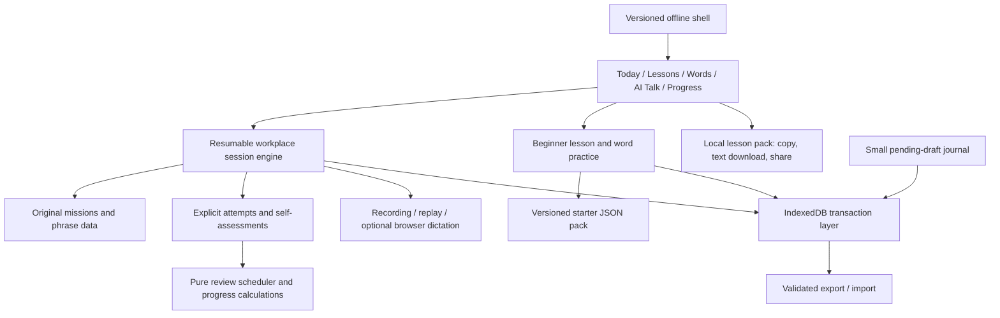

# Architecture · Sprich 2.3

Status: implemented locally. Single learner, Windows/Android, beginner and workplace courses, browser-local progress, optional AI gateway, and manual Gemini handoff.

## ADR-001 · A static, modular JavaScript application

**Status:** accepted and implemented.

**Context:** the original app is a small local-first application. The learner wants a browser-only experience and no paid API.

**Decision:** retain JavaScript ES modules, add Vite for dependable builds, and serve the production output as a static HTTPS site. Hash routing and relative assets support subdirectory hosting. Development defaults to `localhost:8080`, matching the old documented origin.

**Alternatives considered:** a large frontend framework; a server-rendered/full-stack application.

**Consequences:** small runtime payload, no backend account or API operating cost, and explicit ownership of rendering and lifecycle cleanup. Static hosting must supply HTTPS for mobile microphone access.

## ADR-002 · Transactional local progress and portable evidence

**Status:** accepted and implemented.

**Context:** the old store wrote counters to the wrong shape, swallowed errors, and could not retain audio. Phone/computer transfer is required; manual export/import is acceptable.

**Decision:** store a versioned snapshot in IndexedDB and audio blobs in a separate object store. Every state edit reads the latest snapshot inside a read/write transaction. Attempts use stable IDs, and completed attempts and their audio cannot be overwritten by a second tab. Derive schedules and metrics from attempts and measured activity rather than maintaining independent mutable score counters.

**Alternatives considered:** localStorage-only persistence; a hosted account/sync service; normalising every record into separate database tables immediately.

**Consequences:** atomic updates and account-free operation; audio is device-local. The snapshot architecture is intentionally simple for one learner. Time checkpoints coalesce into at most one row per continuous run/minute, reducing long-term snapshot growth. If usage grows substantially, record-level object stores are the next scaling step.

**Recovery:** a small synchronous localStorage journal protects a pending text draft during reload; it is cleared after IndexedDB commits. The journal is validated before recovery. Browser storage errors are surfaced. Export/import validates the entire payload before writing, deduplicates attempts, and merges partial time checkpoints monotonically. Overlapping active intervals are counted once.

**Legacy data:** preserve the original v1 payload as history, but do not turn unreliable old auto-grades into new success evidence. Migration requires the same browser origin.

## ADR-003 · Authored roleplays with transparent feedback

**Status:** accepted and implemented.

**Context:** random follow-ups and four regex rules were presented as an AI conversation partner. The learner prefers free tools and browser-only setup.

**Decision:** use coherent authored scenarios with alternate prompts and an explicit response-intent choice for contextual branching. Record/replay is primary. Listening has fixed checked answers. Open speaking and recall use clearly labelled self-assessment, with guards against assisted or typed answers being called independent speech.

**Alternatives considered:** a paid inference API; a downloadable local language model; extensive free-text regex grading.

**Consequences:** predictable and testable practice without an inference bill. The app cannot judge arbitrary German grammar, pronunciation, or semantic correctness. An editable copy/paste brief supports optional practice in an external free voice tool; there is no automatic connection to that tool.

## ADR-004 · A narrowly scoped offline cache

**Status:** accepted and implemented.

**Context:** core practice should reload offline on Android. Progress and media should remain in IndexedDB.

**Decision:** generate a service worker from the production build's asset list. Cache only the application's own known assets. Use network-first navigation with a cached shell fallback, and cache-first versioned assets. Cache names include both deployment scope and a content revision. A waiting update activates after an explicit Save & update action.

**Alternatives considered:** runtime caching of every request; caching third-party learning audio; a larger PWA framework.

**Consequences:** predictable offline scope and no accidental caching of external/personalised responses. The core can run offline; external resources and network-backed speech services cannot. Same-origin immutable shell assets ignore `Vary` during cache lookup: this prevents a preview/static server's `Vary: Origin` from breaking module/style reloads offline. This exception applies only to the build's allowlist.

## Operational properties

- No production account, database service, or paid model/API dependency.
- Audio capture is user-initiated, limited to three minutes, and stops its microphone tracks when stopped or when leaving the view.
- Late microphone permission results are invalidated by a generation token.
- All user-provided text rendered in templates is HTML-escaped. Imported identifiers and data shapes are validated.
- The active clock excludes hidden/manual-paused/idle periods and bounds suspended timer gaps. Recordings and active study time are different measures.
- Inputs and controls have accessible names, visible keyboard focus, and light/dark styling. Mobile layouts use a bottom navigation bar and single-column task cards.

## ADR-005 · Versioned lesson snapshots and schema 3

**Status:** implemented.

**Context:** adding new dialogue variants or changing short routes must not change an exercise a learner has already started.

**Decision:** each new session contains a bounded content snapshot: its selected task sequence, branching data, relevant phrases, translations, answer keys, and mission metadata. Rendering and grading use this snapshot. Current catalog edits apply to new sessions. The original 2.0 content and ordering logic are frozen in `legacy-content.js` and `legacy-session.js` for migration.

**Consequences:** snapshots add some local storage, but protect meaning as well as cursor position. Schema 2 upgrades to schema 3 in the existing database; IndexedDB version 2 closes obsolete connections during the upgrade. A pre-upgrade snapshot is retained. Imports of old exports pass through the same validated migration.

The schema adds resource sessions, unscored resource artifacts, personal phrases, resource preferences, daily plans/reflections, and assistance metadata. Completed attempts retain stable IDs and are merged once. Saved core-phrase annotations reuse the original recall identity, preventing a second memory track for the same phrase.

## ADR-006 · Guided external resources with explicit evidence

**Status:** implemented.

**Context:** free human audio and workplace material are useful, but visiting another site cannot demonstrate that it was understood, and a static app cannot observe an external tab's study time.

**Decision:** keep publisher media at its source, with level/access/transcript metadata, then require a written response or recording in Sprich to complete a guided activity. Resource outcomes are unscored. Outside-study minutes are self-reported. The existing recorder, active clock, draft journal, and atomic persistence layer also support resource sessions.

**Consequences:** useful input feeds back into speaking and phrase recall without fabricated learning credit. Sources with restricted automated access have visible notices and alternatives and are omitted from automatic daily assignments. An optional browser check is separate from deterministic tests. No publisher media is fetched at startup or added to the offline cache.

## ADR-007 · Stable daily assignments and a bounded core bundle

**Status:** implemented.

**Decision:** persist a daily assignment with actual mission/resource/review IDs and a qualitative reflection. Derive completion from saved evidence. A changed budget or inaccessible resource can adjust the remaining source choice; ordinary completion does not endlessly reroll the plan. The six-stage course counts mission sessions, not phrase/resource sessions.

The build measures compressed JavaScript/CSS and rejects output over 150 KB gzip. New content remains original text and metadata; media is on-demand. Searchable phrase rendering starts with 24 matches and can expand, avoiding a needlessly large initial phrase-card DOM.

## ADR-008 · An optional, owner-locked AI gateway

**Status:** implemented and fixture-verified. No live provider call and no Cloudflare deployment have been made from this workspace.

**Decision:** add AI Talk as an *optional* feature behind a small same-origin gateway on Cloudflare Workers Free + D1, so the core application keeps working with no credentials, no account, and no network. Provider keys stay on the server; clients cannot override the model or provider URL. The page reaches `/api/v1/*` on its own origin, and every mutation is rejected unless the browser's automatically supplied `Origin` matches the gateway's own origin.

Access is a single generated 256-bit owner code exchanged for a signed HttpOnly cookie, which avoids a Cloudflare Zero Trust onboarding dependency and any billing surface. Unlock attempts are rate-limited per hashed client address (5 per 15 minutes, overridable with `AI_AUTH_ATTEMPTS`).

Turns are claimed before generation and finished after it, so an interrupted request is recovered from `GET /api/v1/requests/{requestId}` instead of being generated twice. Only an *unchanged* retry reuses a request ID; edited input returns 409 `request_changed`. Uncertain outcomes (dropped connection, provider timeout, 504) keep their request ID and are never silently replayed. Server-side counters enforce daily, per-minute, review, and speech budgets independently of what the client displays.

Clips are opt-in: nothing leaves the device until the learner chooses Send, and typed answers are labelled as never counting as speaking. The gateway never awards mastery, a CEFR level, or a pronunciation grade; reviews quote the learner's actual words or are withheld.

**Consequences:** missing configuration has a recoverable setup screen, and the offline course works independently. The boundary adds a Worker + D1 deployment and an expiring owner cookie. Provider evidence remains fixture-based; see [TTS/setup verification](TTS_SETUP_VERIFICATION.md) for the current checks and pending live validation.

### TTS and setup follow-up (5 October 2026)

`ai-speech.js` owns playback and generation per view. It checks cancellation after asynchronous work, releases object URLs, stops before microphone recording, and falls back once to the German device service on errors. Settings defaults to device speech and exposes the optional natural voice explicitly.

Generated audio uses the existing IndexedDB cache, keyed by text, model, configured voice ID, test mode, and a synthesis-version marker. Entries live for 30 days with a 60-clip bound and a 2 MB per-clip limit. Playback speed changes locally, so Slower and repeat do not regenerate audio. Cached blobs are excluded from progress exports and cleared with saved audio.

The client encodes JSON input independently of binary response decoding and keeps abort/deadline handling alive through body download. ElevenLabs synthesis requires an explicitly Free account with credit extensions disabled and verified remaining allowance. Device voice selection prefers installed German voices; it has no TTS API quota.

## Verification

- Node tests exercise pure domain rules and IndexedDB behaviour with `fake-indexeddb`.
- Playwright tests exercise the actual production build in desktop and Pixel 7 Chromium emulation, using a synthetic microphone.
- Browser cases include the complete short mission, branching, draft resume, assistance gates, actual MediaRecorder persistence, microphone denial, progress transfer, and offline reload.
- Screenshots are captured for desktop/mobile light/dark dashboards and the speaking view.
- Content tests cover twelve missions × three dialogue variants × normal/short routes, including translations, phrase references, branching, and answer-key shapes.
- Additional browser cases cover resource filtering/bookmarks, unscored artifacts, saved phrases, English support, old backup import, and offline resource metadata.
- AI Talk has its own gateway suite against the real `createGateway` with an in-memory D1-compatible adapter and a mock provider, plus client-side recovery tests and two browser cases that unlock, record, send, and read a review through the production build.

Physical-device voice availability and live interview performance remain outside automated browser tests. They are visible, testable properties of the learner's actual device and conversations, rather than scores inferred by the application.

## ADR-009 · Versioned starter content and separate beginner evidence

**Status:** implemented in 2.2.

**Decision:** introduce a 24-lesson/150-word beginner course as a separate static JSON pack, with a small compiled catalog. Validate and cache the full pack in IndexedDB on first use. The app shell and existing workplace course retain their own service-worker caching. This keeps authored content growth out of the 150 KB core JS/CSS budget while allowing the downloaded starter course to work offline.

Progress schema 5 adds a `starter` collection containing frozen lesson sessions, word sessions, immutable reviews, saved-word markers, and stable day assignments. IndexedDB version 4 adds `coursePacks`. The content cache is not learner progress and is excluded from backups; active lesson and word sessions carry their own snapshots.

Word recognition, spoken retrieval, and sentence use reuse the existing scheduler in separate namespaces. Warm-up repetition is unscored; an answer model prevents an independent self-rating for that attempt. Beginner evidence never enters the old workplace phrase-mastery stream. All new session IDs can be referenced by the existing measured-activity clock.

Schema 2/3/4 imports and local upgrades preserve earlier records and pre-upgrade backups. New immutable results merge by ID; cursor/completion information and later drafts are retained. The pending-draft journal dispatches to the appropriate workplace, beginner, or word store method after a reload.

## ADR-010 · One portable Gemini lesson pack

**Status:** implemented in 2.2.

**Decision:** derive Gemini practice from the selected lesson's content, using a single builder and export component. Beginner lessons export their word targets, forms, patterns, dialogue and variations. Workplace sessions use their frozen content rather than newly edited lesson definitions. The companion selector resolves the chosen lesson instead of always using the first mission.

The browser builds the pack locally. Profile fields are opt-in and allowlisted; the preview is editable. Clipboard failure offers manual selection or text download; native sharing is optional and cancellation is quiet. Export flushes and stops recording first but creates no learning result.

The cross-device workflow is an ordinary Gemini text chat followed by Live in the phone app, or a downloaded text file copied on the phone. Sprich does not automate account access or import external conversation results. User-entered takeaways and outside minutes are stored separately and shown in Progress.

## ADR-011 · A catalog-driven path and multi-pack content

**Status:** implemented in 2.3.

**Decision:** separate *classification* from *content*. pp/data/starter-catalog.js owns levels, topics, speaking skills, modules, path stages, prerequisites, language notes, and pack membership. Authored teaching material lives in versioned JSON packs listed in the same manifest. Classification can therefore be refined without invalidating a learner’s frozen lesson snapshots, which keep only teaching content plus the lesson id, number, and module.

Validation is manifest-driven: alidatePack checks one pack against its own manifest entry, then mergeCourse checks course-wide uniqueness, that every catalog lesson exists, that every word reference resolves, and that no word is untaught. IndexedDB stores one cache entry per pack id, so republishing one pack leaves the others intact; unknown entries are pruned. A failed download reports which content is missing while already-started lessons stay usable from their snapshots.

The path is advisory. Prerequisites are validated to precede their lesson in path order and are rendered as links, never locks. Recommendation order is: resume an unfinished lesson, offer a guided retry after repeated self-marked difficulty, then the first unpractised lesson whose preparation is complete — each with a stated reason. Support mode (guided or light) is stored per session, defaults to guided for pre-2.3 sessions, and changes scaffolding only; the evidence rules for an independent self-rating are unchanged.

Lesson snapshots accept one or several dialogues, so 2.2 progress needs no migration. The session variant selects both the dialogue and the closing variation, making a repeat genuine re-practice.

**Consequence and cost:** the core bundle is now ~146 kB gzip against the 150 KB budget. The remaining A2–B1 workplace content (pp/data/mission-packs/*, phrases.js, legacy-content.js) is roughly 45 kB gzip of source still compiled into the core bundle. Moving it into downloaded packs is the next structural task and is required before significant new core UI.
